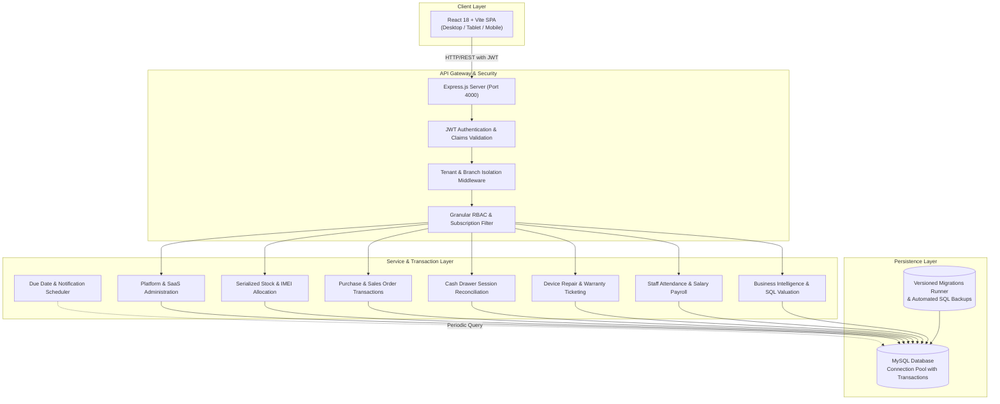
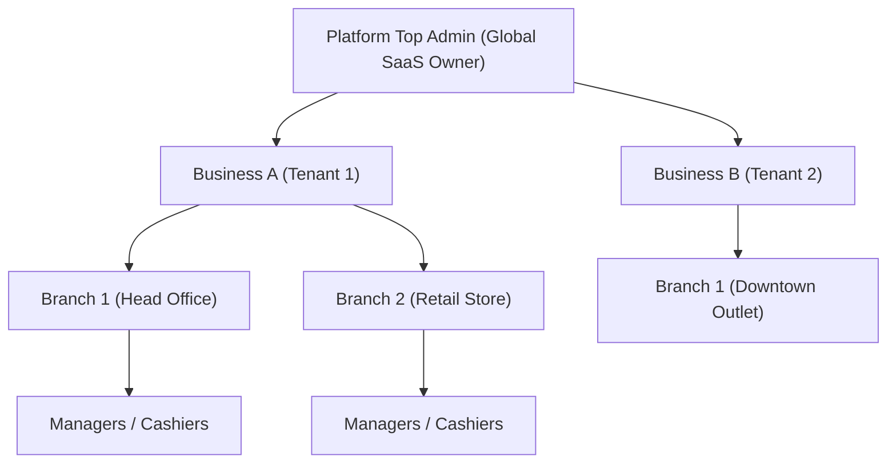
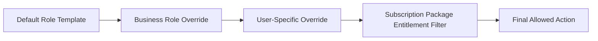
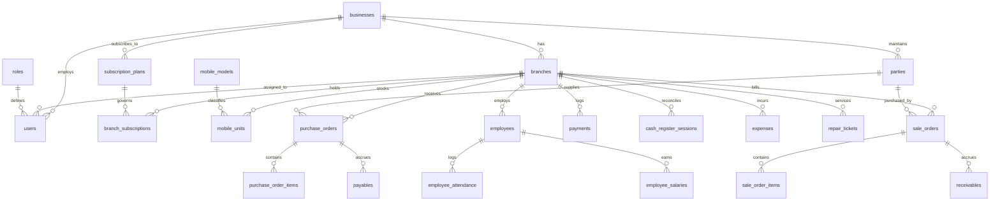

# Mobile POS — System Architecture

## 1. System Overview

**Mobile POS** is a multi-tenant Software-as-a-Service (SaaS) and on-premise ready Retail & Inventory Management Platform designed specifically for mobile handset dealerships, electronics shops, and retail chains.

The platform provides end-to-end management for serialized mobile handset stock (dual IMEI tracking), QR tag sticker printing, accessories inventory, purchase procurement, counter sales billing, credit customer receivables, supplier payables, daily cash register reconciliation, inter-branch inventory transfers, mobile repairs & warranty ticketing, employee attendance & payroll, and partner equity accounting.



---

## 2. Technology Stack

| Layer | Technologies & Libraries | Key Responsibilities |
| :--- | :--- | :--- |
| **Frontend** | React 18, Vite, Vanilla CSS | Fast SPA rendering, responsive UI, fixed sidebar layout, barcode/IMEI scanner, QR sticker tag printer, pure SVG charts, live search and pagination. |
| **Backend** | Node.js (ES Modules), Express.js | REST API routing, business logic orchestration, atomic transaction handling, scheduled background jobs, migration runner. |
| **Database** | MySQL 8.x (`mysql2/promise`) | Relational schema with foreign keys, row-level locking (`FOR UPDATE`), connection pooling, incremental versioned migrations. |
| **Authentication** | JSON Web Tokens (`jsonwebtoken`), `bcryptjs` | Stateless session tokens containing user ID, role, and business scope. |
| **Background Tasks** | Node.js Timers (`reminderScheduler.js`) | Automated checking of overdue receivables, payables, and branch subscription expirations. |
| **Utilities** | Pure JS QR Code, CSV Exporter, WhatsApp API | Zero-dependency QR generation, Excel-compatible UTF-8 BOM CSV exports, click-to-chat WhatsApp reminders. |

---

## 3. Multi-Tenancy & Data Isolation Model

The platform implements a **Logical Shared-Database, Multi-Tenant Architecture** scoped at two organizational tiers: **Business (Tenant)** and **Branch (Physical Store Location)**.



### Data Scoping Rules

1. **Top Admin Scope**:
   - `req.user.role_name === 'top_admin'` has unrestricted access across all businesses, branches, subscription packages, system audit logs, and global billing.
2. **Business Level Scope**:
   - All tenant queries enforce `WHERE business_id = :businessId` via `businessScopeCondition(req.user, tableAlias)`.
   - Business Super Admins can manage all branches, users, employees, and reports within their assigned business.
3. **Branch Level Scope**:
   - Operational staff (`manager`, `cashier`) are bound to a specific `branch_id`.
   - Sensitive operations (creating sales, accessing registers, dispatching stock, payroll) validate access through `assertBranchAccess(req.user, branchId)`.

---

## 4. Role Hierarchy & Granular RBAC

The system employs a three-tier permission resolution pipeline:



### 1. User Roles

| Role | Scope | Purpose & Privileges |
| :--- | :--- | :--- |
| **Top Admin** (`top_admin`) | Global SaaS Platform | Manages businesses, branches, subscription packages, package feature entitlements, pending SaaS payments, company admins, and transaction soft-delete restoration. |
| **Business Super Admin / Admin** (`business_super_admin`, `admin`) | Single Business Tenant | Owns tenant operations. Manages company branches, roles, staff users, custom permission templates, equity partner shares, and inter-branch transfers. |
| **Manager** (`manager`) | Assigned Branch | Supervises branch inventory, approves expenses, verifies cash register sessions, records purchases and sales, manages repairs, attendance, and payroll. |
| **Cashier** (`cashier`) | Assigned Branch | Operational counter billing: creates sales orders, handles walk-in customers, opens/closes cash drawer sessions, takes in repair tickets. |

### 2. Permission Resolution Pipeline

- **Defaults**: Defined in `DEFAULT_ROLE_PERMISSIONS` for `manager` and `cashier`.
- **Business Role Permissions**: Business Admins can customize permission sets for all cashiers or managers in their company (`business_role_permissions`).
- **User Specific Overrides**: Direct per-user permissions in `user_permissions` take highest priority.
- **Subscription Package Gate**: If a business or branch is subscribed to a plan with restricted `allowed_pages`, any permission for a disabled page is automatically gated (`is_allowed = 0`).

---

## 5. Core Business Modules & Workflows

### 5.1 Serialized Mobile Handset Inventory (IMEI Tracking)

- Every handset corresponds to a master catalog model (`mobile_models`) defining brand, model name, color, RAM/storage variant.
- Individual units are tracked in `mobile_units` with unique `imei_1` and optional `imei_2`, serial numbers, cost price, selling price, and lifecycle status (`in_stock`, `sold`, `transferred`, `returned`).
- Non-serialized items (chargers, screen protectors, cases) are managed under `products` and `product_stocks` with quantity counters.

### 5.2 QR-Based Tag Sticker Printing for Mobile Handsets

- Integrated QR label generator (`PhoneQRTagModal.jsx` and `qrcode.jsx`).
- Formats adhesive sticker labels containing:
  1. **Company Name** (Shop / Tenant header)
  2. **Device Model Name** (Brand, model, specs)
  3. **QR Code** (Encodes IMEI, model name, and shop details)
  4. **IMEI 1 / Serial**
  5. **Cost or Retail Price**
- Available immediately upon purchase order receipt or on-demand from the inventory register.

### 5.3 Purchasing & Stock Intake

- Bulk intake of serialized handsets and accessories.
- Generates `purchase_orders`, auto-allocates `mobile_units`, logs `stock_movements`, records payables, and triggers immediate QR sticker tag printing.

### 5.4 Point of Sale (POS), Billing & Returns

- Row-level locking (`SELECT ... FOR UPDATE`) prevents double-selling.
- Supports printable standard A4 invoice layouts and 58mm / 80mm thermal POS receipts.
- **Sale Returns**: Reverse customer sales, return units to stock or mark damaged, calculate refunds, adjust customer receivables.
- **Purchase Returns**: Return units to vendor, deduct stock, reduce accounts payable.

### 5.5 Cash Register Drawer Lifecycle

- Daily drawer opening cash submission.
- Real-time tally:
  $$\text{Expected Cash} = \text{Opening Cash} + \text{Cash In} - \text{Cash Out} - \text{Expenses}$$
- Closing cash reconciliation with discrepancy tracking and store manager sign-off.

### 5.6 Device Repairs & Warranty Ticketing

- Full lifecycle device repair tracking: `received` $\rightarrow$ `diagnosing` $\rightarrow$ `waiting_parts` $\rightarrow$ `repaired` $\rightarrow$ `delivered` $\rightarrow$ `cancelled`.
- Records customer name/phone, device model, IMEI, defect description, estimated cost, advance paid, and assigned technician.
- Calculates warranty expiration upon delivery.
- One-click WhatsApp update button notifies customer when device is repaired and ready for pickup.

### 5.7 Employee Attendance & Monthly Payroll

- **Staff Directory**: Register employees, designations, CNICs, monthly base salaries, and store branches.
- **Daily Attendance Register**: Daily roll call marking present, absent, half-day, or leave with check-in/out times.
- **Monthly Payroll**: Automated calculation of base salary + bonuses - attendance deductions = net salary.
- Automatically creates entries in `expenses` (`category = 'Salaries'`) to reflect in cash registers and profit calculations.

### 5.8 Business Intelligence & Reports

- **Inventory Valuation**: Total cost valuation, potential retail revenue, projected gross margins, and brand distribution donut chart.
- **Customer Receivables Aging**: Aging balances with direct "Send WhatsApp Reminder" button.
- **Supplier Payables**: Upcoming procurement debts.
- **Revenue Trends**: Pure SVG bar charts tracking turnover trajectories.

### 5.9 Inter-Branch Transfers & Soft-Delete Recovery

- Safe inter-branch stock dispatch and receipt confirmation.
- Full soft deletion (`is_deleted = 1`) and Top Admin audit restoration for sales, purchases, and expenses.

---

## 6. Database Entity Relationship (ER) Model

The database contains 37 tables organized by functional domain:



### Table Directory

1. **Multi-Tenancy & Authorization**: `businesses`, `branches`, `roles`, `users`, `user_permissions`, `business_role_permissions`.
2. **SaaS Subscriptions**: `subscription_plans`, `branch_subscriptions`, `subscription_payments`.
3. **Catalog & Serialized Inventory**: `mobile_models`, `mobile_units`, `categories`, `products`, `product_stocks`, `stock_movements`.
4. **Order Management**: `purchase_orders`, `purchase_order_items`, `sale_orders`, `sale_order_items`, `order_returns`, `order_return_items`, `stock_transfers`, `stock_transfer_items`.
5. **Ledgers & Financials**: `parties`, `receivables`, `payables`, `payments`, `cash_register_sessions`, `expenses`.
6. **Repairs & HR**: `repair_tickets`, `employees`, `employee_attendance`, `employee_salaries`.
7. **Governance, Migrations & Alerts**: `audit_logs`, `notifications`, `partners`, `partner_branch_shares`, `schema_migrations`.

---

## 7. Frontend Architecture

```
frontend/src/
├── api.js                           # API client with JWT claims propagation
├── App.jsx                          # Main shell, responsive navigation, role routing
├── main.jsx                         # React root mount
├── styles.css                       # Themes (Dark, Emerald, Cobalt, Crimson), print styles
├── components/
│   ├── Charts.jsx                   # Pure SVG BarChart and DonutChart
│   ├── LineItemScanner.jsx          # Barcode & IMEI scanner interface
│   ├── PaginationBar.jsx            # Universal pagination controls
│   ├── PhoneQRTagModal.jsx          # QR sticker tag printing modal for handsets
│   ├── ReturnOrderModal.jsx         # Sale return and purchase return modal
│   ├── SectionCard.jsx              # Standard UI container
│   ├── StatCard.jsx                 # KPI counter card
│   └── ToggleSwitch.jsx             # Active/inactive toggle
├── utils/
│   ├── export.js                    # Universal UTF-8 BOM CSV exporter
│   ├── qrcode.jsx                   # Pure JS SVG QR code generator
│   └── whatsapp.js                  # Click-to-chat WhatsApp reminder link generator
└── pages/
    ├── LoginPage.jsx
    ├── DashboardPage.jsx            # KPI cards & visual analytics charts
    ├── PurchasesPage.jsx            # Purchases with immediate QR tag printing
    ├── SalesPage.jsx                # POS sales & quick customer creation
    ├── InvoicesPage.jsx             # Invoices, thermal slips, returns, WhatsApp alerts
    ├── InventoryPage.jsx            # IMEI units, accessories, transfers, QR tag labels
    ├── RepairsPage.jsx              # Mobile device repairs & warranty ticketing
    ├── EmployeesPage.jsx            # Staff directory, daily attendance, payroll
    ├── ReportsPage.jsx              # Inventory valuation, receivables aging, trends
    ├── CashRegisterPage.jsx
    ├── PartiesPage.jsx
    ├── ExpensesPage.jsx
    ├── AdminPage.jsx
    ├── TopDashboard.jsx
    ├── TopBusinessesPage.jsx
    ├── TopPackagesPage.jsx
    ├── TopPackageAccessPage.jsx
    ├── TopPaymentsPage.jsx
    ├── TopAdminsPage.jsx
    └── TopDeletedTransactionsPage.jsx
```

---

## 8. Database Migrations & Backup Automation

- **Versioned Migrations Runner**: `backend/src/db/migrate.js` (`npm run migrate`) tracking executed files in `schema_migrations`.
- **Automated Database Backups**: `backend/src/db/backup.js` (`npm run backup`) producing clean, standalone SQL dump files in `backend/backups/`.
