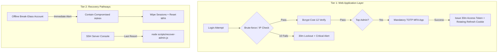

# SaaS Top Admin Security & Incident Recovery Runbook

> **Target:** DigitalMarkaz360 / Mobile POS SaaS Platform  
> **Classification:** High-Security Operational Protocol (Top Admin Recovery)  
> **Golden Rule:** Protect the Top Admin vault like a bank vault. Maintain an immutable recovery path that does NOT depend on web application authentication.

---

## Part 1 — Threat Model & Architecture Overview

The SaaS Top Admin account controls every tenant company, subscription package, branch, and role in the platform. An attacker with this credential possesses global read/write control.



---

## Part 2 — Incident Recovery: 7-Step Protocol

If you suspect the SaaS Top Admin account has been compromised, perform Steps 1–4 within the **first 60 minutes**.

### Step 1: CONTAIN (First 15 Minutes)
1. Retrieve the **Emergency Break-Glass Account** credentials from your offline secure storage.
2. Log in using the break-glass account (`breakglass@digitalmarkaz360.local`).
   > *Note: This immediately triggers a critical alert to the registered owner email.*
3. Execute the containment API or admin action:
   ```bash
   curl -X POST http://localhost:4000/api/admin/emergency/contain-account \
     -H "Content-Type: application/json" \
     -H "Authorization: Bearer <BREAK_GLASS_TOKEN>" \
     -d '{"targetUserId": 1, "reason": "Suspected unauthorized access"}'
   ```
4. **Result:** The compromised admin account is instantly set to `is_active = 0`, locked, and all active sessions across all devices are immediately terminated.

---

### Step 2: ROTATE JWT SIGNING SECRET
1. Log in to the server environment (e.g., VPS / container environment).
2. Generate a new high-entropy JWT secret:
   ```bash
   node -e "console.log(require('crypto').randomBytes(64).toString('hex'))"
   ```
3. Update `JWT_SECRET` in `.env` and restart the backend service:
   ```bash
   # In backend service manager (systemd / pm2 / docker)
   npm run start
   ```
4. **Result:** Every existing access token across the entire platform dies instantly.

---

### Step 3: RESET THE MAIN LOGIN
1. While still authenticated as Break-Glass Admin, trigger account recovery:
   ```bash
   curl -X POST http://localhost:4000/api/admin/emergency/recover-account \
     -H "Content-Type: application/json" \
     -H "Authorization: Bearer <BREAK_GLASS_TOKEN>" \
     -d '{
       "targetUserId": 1,
       "newPassword": "TemporaryStrongPassword2026!#",
       "correctEmail": "verified-owner@digitalmarkaz360.com"
     }'
   ```
2. **Result:**
   - Account re-enabled with strong temporary password.
   - Attacker-controlled MFA secrets and old recovery codes are permanently deleted.
   - Account is flagged with `must_change_password = 1` and `mfa_enabled = 0`.
   - On first login, the owner is forced to enter a new password and enroll fresh TOTP MFA.

---

### Step 4: HUNT FOR BACKDOORS IN AUDIT LOG
Inspect the append-only `audit_logs` table for any unauthorized administrative actions taken by the attacker:
```sql
SELECT id, user_id, action_type, entity_type, entity_id, details, ip_address, created_at
FROM audit_logs
WHERE created_at >= DATE_SUB(NOW(), INTERVAL 72 HOUR)
ORDER BY id DESC;
```
Check specifically for:
- New company administrators or staff accounts created.
- Altered subscription packages or free trial extensions.
- Modified partner dividend splits or branch assignments.
- Any manual data deletion or export calls.

Revert any unauthorized database changes identified in the log.

---

### Step 5: ASSESS DAMAGE & TENANT TRANSPARENCY
1. From the audit log, compile a list of all tenants whose data was viewed, exported, or modified.
2. If tenant financial or customer records were accessed, provide timely disclosure in accordance with data protection best practices.

---

### Step 6: LAST RESORT — SERVER-LEVEL CLI RECOVERY
If **both** the main Top Admin and Break-Glass accounts are locked out or lost:

1. Connect to the host server via SSH console.
2. Navigate to the backend directory:
   ```bash
   cd /path/to/POS/backend
   ```
3. Execute the direct server-level recovery tool (bypasses web login entirely):
   ```bash
   node scripts/recover-admin.js --email verified-owner@digitalmarkaz360.com
   ```
4. **Output will provide a one-time temporary recovery password.**
5. The tool directly updates MySQL, purges all sessions and recovery codes, and records an immutable CLI recovery audit record.
6. Log in via the browser and immediately complete password change + TOTP MFA enrollment.

---

### Step 7: RESTORE FROM BACKUP (IF DATA TAMPERED)
If the database was vandalized beyond audit log rollback:
1. Verify the integrity of the latest clean automated daily backup in `backend/backups/`.
2. Restore database:
   ```bash
   mysql -u root -p mobile_pos < backups/clean_backup_YYYY-MM-DD.sql
   ```
3. Re-play legitimate business transactions logged in the audit trail between the backup timestamp and the incident containment timestamp.

---

## Part 3 — Owner Security Protocol (Human Responsibilities)

* **Email Account Master Key:** The email receiving alerts (`verified-owner@...`) must have Hardware Security Key (FIDO2/WebAuthn) or TOTP MFA enabled. It must not share passwords with any other service.
* **Break-Glass Offline Key:** The break-glass account password and seed must be stored in a physical safe, written on paper, sealed in a tamper-evident envelope.
* **Infrastructure Security:** Domain registrar, DNS provider (Cloudflare), and VPS host (AWS/DigitalOcean/Hetzner) must have mandatory MFA enabled.
* **Zero Shared Terminals:** Never access the SaaS Top Admin panel from untrusted or public devices.
