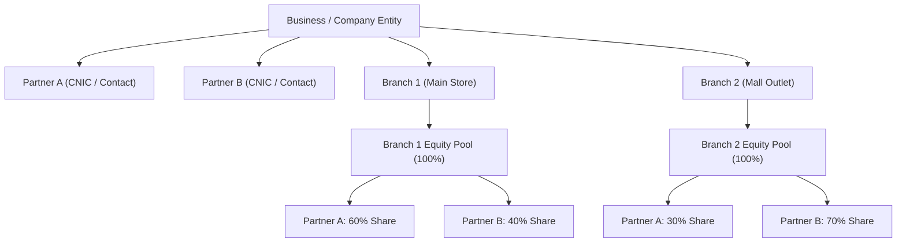
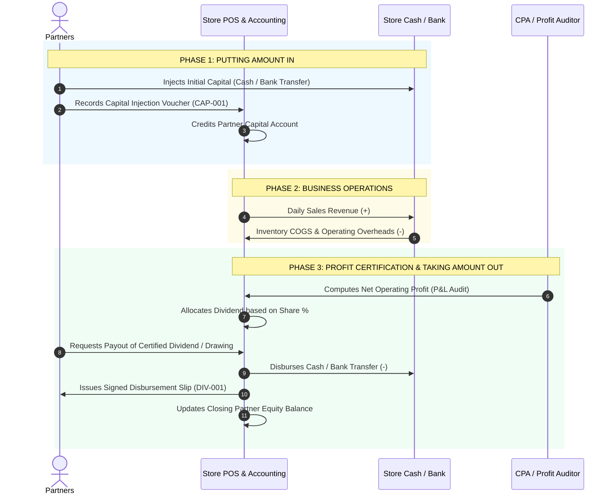

# Partnership Architecture, Capital Inflows, & Payout Workflow Plan

## Goal Description
This document provides a comprehensive financial and architectural plan answering:
1. **How the Partnership Works**: How equity, branches, risk sharing, and profit-sharing ratios are structured.
2. **How Amount is Put Into Company Business**: How initial capital investments and subsequent capital injections are deposited, accounted for, and deployed into store operations.
3. **How and When Amount is Taken Out**: The accounting rules, timing triggers (monthly/quarterly dividend settlements vs. interim drawings vs. capital return), and cash disbursement methods.
4. **Implementation Plan**: Upgrading the POS system to transition from purely calculating dividend percentages on paper to an end-to-end **Partner Capital & Drawings Management System** with transaction receipts, running equity balances, and official printable disbursement vouchers.

---

## 1. How the Partnership Model Works

### A. Ownership & Branch Equity Structure
In this POS system, a partnership operates under an **Equity-by-Branch Model**:
- **Company Partners**: Partners are registered entities at the business level with legal credentials (Full Name, Phone, CNIC / National Tax ID).
- **Branch Equity Allocation**: Each physical store outlet (or branch) has an independent capital and profit pool. Partners hold designated **Share Percentages (%)** per branch.
- **Strict 100% Validation**: The sum of all active partner shares for any branch must equal exactly `100.00%`.



---

## 2. How Amount is Put Into Company Business (Capital Inflows)

In business accounting, funds put into the business by partners are **not revenue**—they are **Partner Capital Injections (Equity Additions)**.

### A. When is Amount Put In?
1. **Initial Store Setup / Launch Capital**:
   - Initial cash pooled to pay branch lease deposits, shop fixtures, renovations, and initial phone/accessory inventory purchases.
2. **Working Capital Expansion / Bulk Procurement**:
   - Injecting additional cash when the store needs to import a large consignment of handsets (e.g., iPhone launch) or open a new counter.
3. **Loss Absorption / Emergency Cash Injections**:
   - In periods where operating expenses exceed gross profit (loss period), partners inject cash to keep creditors and payroll funded.

### B. Accounting Mechanics (Double Entry)
When Partner A deposits Rs. 1,000,000 into Branch 1:
- **Debit (+)**: Store Cash Register or Company Bank Account (Asset increases).
- **Credit (+)**: Partner A Capital Account (Partner Equity increases).

$$\text{Total Branch Assets} = \text{Branch Liabilities} + \text{Partners' Capital}$$

---

## 3. How and When Amount is Taken Out (Capital Outflows)

In professional partnership accounting, money is withdrawn from the business through three distinct channels:

| Withdrawal Type | Description | When It Occurs | Accounting Impact |
| :--- | :--- | :--- | :--- |
| **1. Certified Profit Dividends** | Distribution of verified net operating profit after all COGS and operating expenses are cleared. | At the close of an accounting cycle (Monthly, Quarterly, or Annually). | Deducts from Period Retained Earnings; credits Partner Cash. |
| **2. Partner Drawings** | Interim personal withdrawals or advances taken by a partner during the operating cycle. | As needed, subject to managing partner approval and limits. | Decreases Partner Capital / Equity Account immediately. Settled against final dividend. |
| **3. Capital Reduction / Exit** | A partner withdraws part or all of their original invested capital (e.g. retiring or selling share). | On partnership agreement restructuring or dissolution. | Decreases total store capital pool; requires equity share reassignment to 100%. |



### C. The Fundamental Partner Capital Equation
$$\text{Closing Equity Balance} = \text{Opening Capital} + \text{Capital Injected} + \text{Share of Net Profit} - \text{Dividends Disbursed} - \text{Interim Drawings} - \text{Share of Net Loss}$$

---

## User Review Required

> [!IMPORTANT]
> **Current System Status vs. New Capability**:
> - **Currently**: The POS system records partner share percentages and computes the *theoretical dividend* in the Dividend Report (`/api/reports/dividends`). However, it has **no transaction table** to record when money is actually deposited or withdrawn!
> - **Proposed Upgrade**: We will implement a full **Partner Transaction Ledger (`partner_transactions`)** allowing the business to record:
>   1. Capital Deposits (Money IN) with payment channel and notes.
>   2. Dividend Payouts (Money OUT) with 1-click disbursement from the Dividend Report.
>   3. Interim Drawings (Money OUT) to prevent unrecorded cash leakage.
>   4. Official Printable Payment Vouchers for audit and partner signatures.

---

## Open Questions

> [!NOTE]
> 1. **Cash Register Integration**: When a partner withdraws dividends in cash from a branch register, should this automatically register as a "Cash Out" in that day's Cash Register Session? *(Recommended: Yes, with transaction reference `DIV-XXXX`).*
> 2. **Loss Handling**: If a branch incurs a loss in a month, should the loss reduce the partner's capital balance directly, or accumulate in a negative dividend balance to be offset against future profits? *(Recommended: Reduce partner capital balance, adhering to standard partnership equity accounting).*

---

## Proposed Changes

Grouped logically by architecture layer.

---

### Database Layer (`backend/src/db/`)

#### [NEW] Table: `partner_transactions`
We will add a dedicated ledger table tracking every monetary inflow and outflow per partner and branch:

```sql
CREATE TABLE IF NOT EXISTS partner_transactions (
  id INT AUTO_INCREMENT PRIMARY KEY,
  business_id INT NOT NULL,
  branch_id INT NOT NULL,
  partner_id INT NOT NULL,
  transaction_type ENUM('capital_injection', 'dividend_payout', 'drawing', 'capital_withdrawal') NOT NULL,
  direction ENUM('in', 'out') NOT NULL,
  amount DECIMAL(12,2) NOT NULL,
  payment_method ENUM('cash', 'bank_transfer', 'cheque', 'online') NOT NULL DEFAULT 'cash',
  transaction_date DATE NOT NULL,
  voucher_number VARCHAR(60) NOT NULL UNIQUE,
  period_label VARCHAR(60) NULL, -- e.g. "October 2026", "Q3 2026"
  reference_details VARCHAR(255) NULL, -- Bank slip #, Cheque #
  notes TEXT NULL,
  created_by INT NOT NULL,
  created_at TIMESTAMP DEFAULT CURRENT_TIMESTAMP,
  INDEX idx_pt_partner (business_id, partner_id),
  INDEX idx_pt_branch (business_id, branch_id),
  INDEX idx_pt_date (transaction_date),
  FOREIGN KEY (business_id) REFERENCES businesses(id),
  FOREIGN KEY (branch_id) REFERENCES branches(id),
  FOREIGN KEY (partner_id) REFERENCES partners(id) ON DELETE CASCADE,
  FOREIGN KEY (created_by) REFERENCES users(id)
);
```

---

### Backend API Layer (`backend/src/routes/modules/`)

#### [MODIFY] `partners.js`
Add endpoints for recording transactions and calculating real-time capital ledgers:

1. **`GET /api/partners/:id/ledger`**:
   - Returns complete chronological ledger for a partner:
     - Opening balance
     - Capital Injections (+)
     - Profit allocations (+)
     - Dividend payouts (-)
     - Drawings (-)
     - Running closing equity balance.
2. **`POST /api/partners/:id/transactions`**:
   - Records capital injection, drawing, or capital withdrawal with auto-generated voucher number (`CAP-YYYY-XXXX` or `DRW-YYYY-XXXX`).
3. **`POST /api/partners/branches/:branchId/disburse-dividends`**:
   - 1-click batch or individual disbursement of certified dividends computed for the selected period.
   - Creates `partner_transactions` records with voucher type `DIV-YYYY-XXXX`.
   - Optionally logs cash-out to `cash_register_sessions` if payment method is `cash`.

#### [MODIFY] `reports.js`
Update `reportDividends` endpoint to include:
- Total historical capital invested by each partner.
- Cumulative dividends previously paid out vs. currently pending payable.
- Net remaining equity balance.

---

### Frontend UI Layer (`frontend/src/`)

#### [MODIFY] `frontend/src/pages/AdminPage.jsx` (`Partners & Equity` Sub-Page)
- Add **"Partner Capital & Investment Ledger"** card:
  - Table displaying each partner's registered capital, total payouts received, and current balance.
  - Action button: **"➕ Deposit Capital"** modal form allowing admins to record initial or additional funds invested (amount, branch, date, bank/cash details).
  - Action button: **"➖ Record Drawing"** modal form.

#### [MODIFY] `frontend/src/pages/ReportsPage.jsx` (`Partner Dividends` Tab)
- Enhance the **Partner Dividend Allocation Table**:
  - Add a **"Disburse / Pay Out"** button on each eligible partner row when dividends are payable.
  - Clicking opens the **Dividend Disbursement Voucher Dialog**:
    - Select payment channel (Cash from Register, Bank Transfer, Cheque).
    - Print official **Partner Dividend Payment Voucher** with signature sign-offs.
  - Display actual settlement status: `Paid (Voucher #DIV-104)` vs `Unclaimed / Retained`.

#### [NEW] `frontend/src/components/PartnerVoucherModal.jsx`
- Printable official A4 / receipt slip for partner cash movements (Capital Deposit Receipt or Dividend Payment Slip).

---

## Verification Plan

### Automated Tests
1. **Schema Migration Test**:
   - Verify table creation, indexes, and constraints in `migrateBusinessAdmin.js`.
2. **Transaction & Balance Tests** (`backend/tests/partner_transactions.test.js`):
   - Test depositing capital increases partner capital balance.
   - Test recording drawings reduces partner capital balance.
   - Test dividend disbursement validation and duplicate payout prevention.
   - Test branch-specific access permissions.

### Manual Verification
1. **Deposit Money IN**:
   - Go to Admin ➔ Partners & Equity.
   - Click "Deposit Capital" for Partner A: Deposit Rs. 500,000 to Branch 1.
   - Verify ledger updates and voucher `CAP-2026-0001` is generated.
2. **Operate Store & Generate Profit**:
   - Complete sales transactions in Branch 1 to generate positive net profit.
3. **Take Money OUT (Dividend Disbursement)**:
   - Navigate to Reports ➔ Partner Dividends.
   - Verify computed dividend amount for Partner A.
   - Click "Disburse Dividend", select Cash, and submit.
   - Verify printable payment voucher displays partner name, CNIC, amount, and signature fields.
   - Verify partner ledger reflects payout and reduces payable balance.
